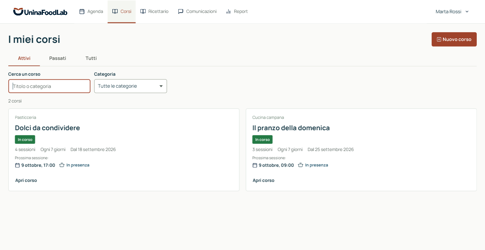
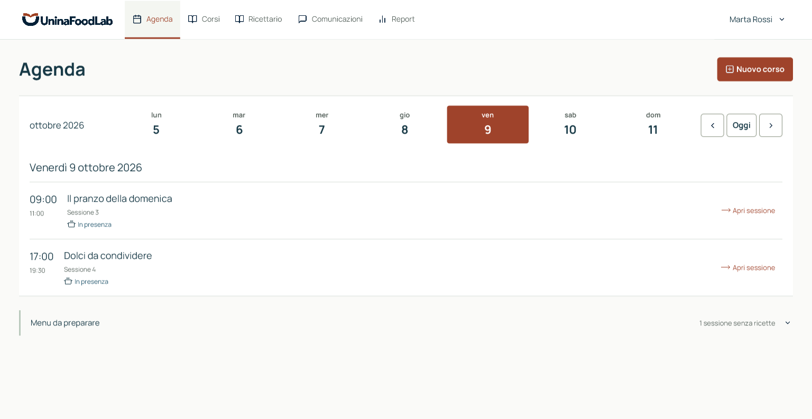
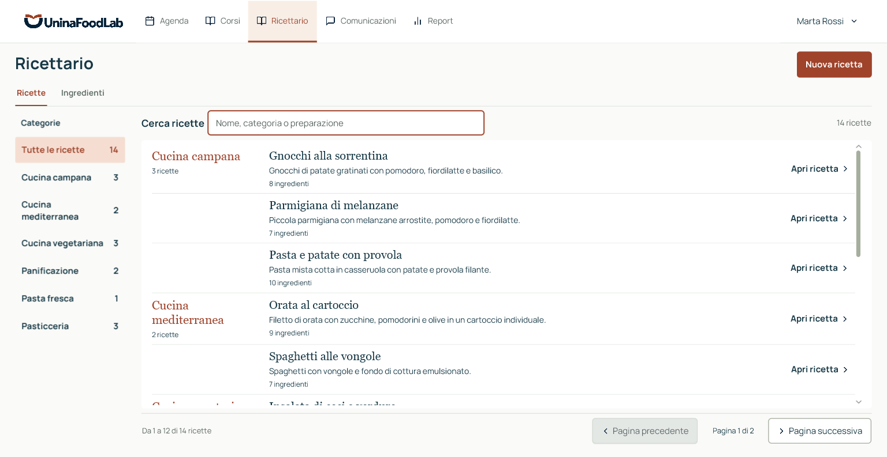
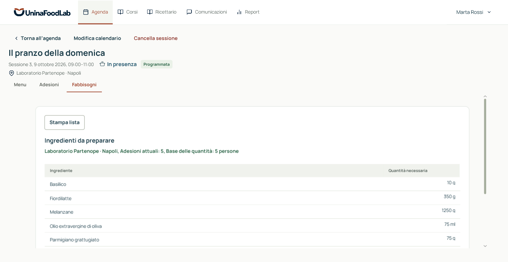
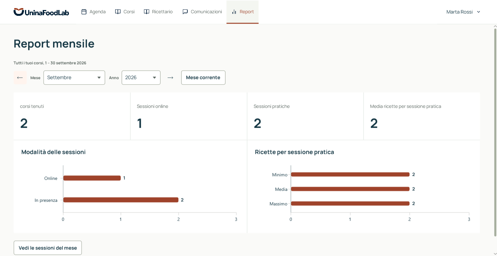
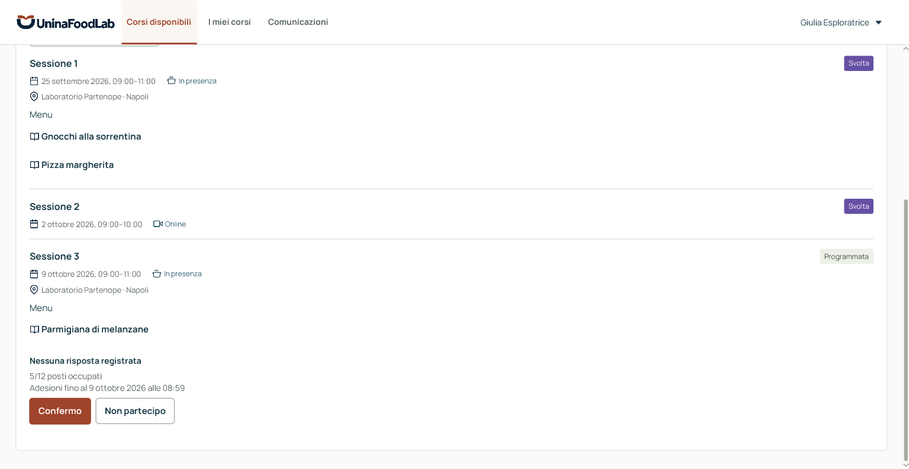

# UninaFoodLab

UninaFoodLab è un'applicazione desktop per chef e partecipanti ai corsi di cucina. Permette di organizzare le sessioni, raccogliere le adesioni e calcolare gli ingredienti necessari, così da pianificare le preparazioni e limitare gli sprechi.

Il progetto d'esame universitario di **Basi di Dati e Programmazione Object Oriented**, valutato **30/30**, segue la traccia UninaFoodLab dell'anno accademico **2024/2025**.

## Cosa permette di fare

- **Chef:** crea corsi tematici, organizza sessioni online o in presenza e associa una o più ricette alle sessioni pratiche. Può consultare l'agenda, modificare gli appuntamenti e comunicare le variazioni agli iscritti.
- **Partecipante:** consulta i corsi pubblicati, si iscrive e conferma la partecipazione alle singole sessioni pratiche. Può leggere il programma, le comunicazioni e le ricette delle proprie sessioni.
- **Ricettario e pianificazione:** lo chef gestisce ingredienti e dosi per una persona. Le conferme dei partecipanti servono a calcolare le quantità per le sessioni pratiche e a stampare la lista della spesa.
- **Report mensile:** mostra i corsi tenuti, le sessioni online e pratiche svolte e la media, il minimo e il massimo delle ricette associate alle pratiche.

Le ricette associate a una sessione conservano una copia delle dosi: modificare il ricettario non cambia le preparazioni già salvate. Le comunicazioni sono consultabili nell'applicazione; non è previsto l'invio di email o SMS.

Una sessione non annullata viene considerata svolta alla fine prevista, nel fuso Europe/Rome, senza conferma manuale. Il report assume che le ricette del menu della sessione siano state realizzate e attribuisce le sessioni al mese dell'appuntamento. Spostare un appuntamento richiede una nuova adesione; correggere soltanto sede, link o scadenza conserva le conferme.

## Schermate dell'applicazione

Le immagini mostrano l'applicazione desktop JavaFX collegata a PostgreSQL, con corsi, ricette, iscrizioni e adesioni della demo locale. Tutti i dati e i nomi visualizzati sono sintetici.

### Corsi e agenda dello Chef

I corsi attivi mostrano categoria, frequenza e prossimo appuntamento. L'agenda raccoglie le sessioni del giorno e permette di aprirne il dettaglio.





### Ricettario e fabbisogni

Il ricettario organizza le ricette per categoria e indica gli ingredienti di ciascuna preparazione. Per ogni sessione pratica, i fabbisogni combinano le dosi del menu con le adesioni: nell'esempio, le quantità sono calcolate per cinque persone.





### Report mensile

Il report di settembre mostra i corsi tenuti, le sessioni svolte e gli indicatori sulle ricette, con due grafici di riepilogo.



### Area Partecipante

Il programma del corso distingue sessioni svolte e future, mostra le ricette del menu e permette di rispondere all'invito per una pratica. La schermata include i posti occupati e la scadenza delle adesioni.



## Tecnologie e struttura

Il progetto usa **Java 25**, **JavaFX** per l'interfaccia e **PostgreSQL** per i dati. Le schermate sono definite con FXML e CSS. Maven gestisce compilazione e dipendenze; il Maven Wrapper incluso permette di usarlo senza installarlo separatamente.

L'accesso al database avviene con JDBC e un pool di connessioni HikariCP. Flyway applica le migrazioni, cioè le modifiche versionate allo schema del database. Vincoli, funzioni e trigger SQL contribuiscono a mantenere coerenti i dati.

I sorgenti sono divisi in quattro livelli, nella cartella [src/main/java/it/uninafoodlab](src/main/java/it/uninafoodlab):

| Livello | Responsabilità |
| --- | --- |
| `presentation` | Schermate JavaFX, navigazione e gestione degli input. |
| `application` | Operazioni disponibili all'utente e coordinamento dei casi d'uso. |
| `domain` | Oggetti e regole del dominio, indipendenti dall'interfaccia e da JDBC. |
| `infrastructure` | Accesso a PostgreSQL, configurazione e preparazione dei dati demo. |

Lo schema iniziale consolidato è definito dalla [migrazione V001](src/main/resources/db/migration/V001__create_initial_schema.sql). Le [migrazioni successive](src/main/resources/db/migration) aggiornano lo schema conservando i dati: la [V002](src/main/resources/db/migration/V002__protect_past_session_schedules.sql) impedisce lo spostamento delle sessioni già iniziate o concluse, anche quando non si modifica la sede o il link. La creazione dei ruoli PostgreSQL e i dati demo restano separati; i test si trovano in [src/test/java](src/test/java).

## Avvio locale

La procedura seguente è pensata per Windows. Servono:

- PowerShell **7.2 o successivo**;
- un **JDK 25 completo**, con `JAVA_HOME` impostato sulla cartella che contiene `bin/javac.exe`;
- Docker Desktop avviato, con Docker Compose disponibile.

Per ottenere il progetto con Git, eseguire:

```powershell
git clone https://github.com/Daniele04-creator/UninaFoodLab.git
Set-Location UninaFoodLab
```

In alternativa, estrarre l'archivio del repository e aprire PowerShell nella cartella che contiene `pom.xml`. I comandi seguenti vanno eseguiti in questa cartella.

Per iniziare senza dati dimostrativi, eseguire:

```powershell
.\scripts\start-local.ps1
```

Al primo avvio lo script crea `.env` con password casuali, avvia PostgreSQL e apre la schermata di accesso. Le migrazioni vengono applicate all'avvio dell'applicazione. Si può creare un account scegliendo il ruolo Chef o Partecipante.

Il file `.env` contiene la configurazione locale e non va condiviso. I dati rimangono nel volume Docker anche dopo la chiusura dell'applicazione.

Il primo avvio scarica le dipendenze Maven e l'immagine PostgreSQL: richiede una connessione Internet e può durare più degli avvii successivi. Il solo database si prepara con `.\scripts\start-local.ps1 -NoLaunch`.

Se la porta predefinita `55432` è occupata o riservata dal sistema, scegliere una porta libera e aggiornare **entrambi** i valori in `.env`. Per esempio:

```dotenv
UNINAFOODLAB_DB_PORT=15433
UNINAFOODLAB_DB_URL=jdbc:postgresql://localhost:15433/uninafoodlab
```

Il nome del database nell'URL deve coincidere con `UNINAFOODLAB_DB_NAME`. Dopo la modifica, rieseguire lo script di avvio.

## Dati dimostrativi

Per provare le funzionalità con corsi, ricette e utenti sintetici, scegliere questa procedura prima di registrare account o inserire dati:

```powershell
.\scripts\prepare-demo.ps1
.\scripts\start-local.ps1
```

La prima inizializzazione richiede un database locale vuoto e `UNINAFOODLAB_ENV=development`, impostazione predefinita. Lo script mostra le credenziali degli account demo alla prima preparazione. Questi account servono soltanto a provare l'applicazione.

Se la demo è già inizializzata, rieseguire lo script conserva i dati e le modifiche. Un database non vuoto che non contiene la demo viene rifiutato. Non occorre cancellare volumi per avviare o aggiornare il progetto.

## Verifiche

Con JDK 25 e Docker attivo, dalla radice del repository:

```powershell
.\mvnw.cmd verify
```

Il comando esegue i test JUnit, i test di integrazione con PostgreSQL tramite Testcontainers e i controlli su architettura, codice e copertura. Testcontainers crea database temporanei separati da quello usato dall'applicazione.

Il [workflow Verify](.github/workflows/verify.yml), visibile nella [sezione Actions](https://github.com/Daniele04-creator/UninaFoodLab/actions/workflows/verify.yml), esegue `./mvnw verify` con JDK 25 su Ubuntu e conserva i report dei test e della copertura.

## Documentazione tecnica

La [relazione di progetto in PDF](output/pdf/uninafoodlab-project.pdf) raccoglie requisiti e assunzioni, modelli UML ed ER, dizionari delle classi, associazioni e vincoli, schema logico, classi di design e due diagrammi di sequenza. La persistenza è illustrata con casi SQL significativi e le motivazioni delle scelte; il codice completo dello schema e dei suoi aggiornamenti si trova nelle [migrazioni Flyway](src/main/resources/db/migration). Il [sorgente LaTeX](docs/project-documentation.tex) contiene anche i diagrammi e può essere modificato e ricompilato.

## Licenza

Il codice del progetto è distribuito con [licenza MIT](LICENSE). Le risorse includono il font [Manrope, con licenza SIL Open Font License](src/main/resources/it/uninafoodlab/presentation/assets/fonts/Manrope-OFL.txt), le [icone Feather, con licenza MIT](src/main/resources/it/uninafoodlab/presentation/assets/feather/LICENSE.txt) e le [icone Phosphor, con licenza MIT](src/main/resources/it/uninafoodlab/presentation/assets/feather/PHOSPHOR-LICENSE.txt).
